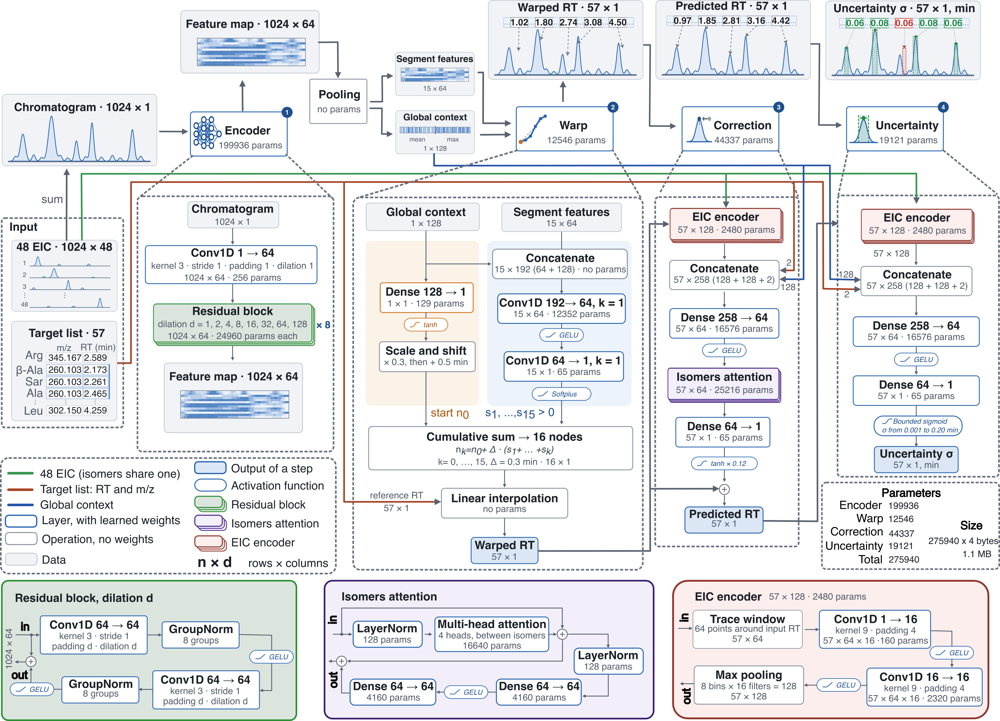

# deepwarp

Predict where each target elutes in an LC-MS run.

## Usage

```python
import numpy as np
import quantion

import deepwarp

def read_file(file, options):
    targets = options["targets"]
    grid = np.linspace(options["time_from"], options["time_to"], options["points"])
    eic = {"from": options["time_from"] - 0.05, "to": options["time_to"] + 0.05, "ppm_tolerance": options["ppm_tolerance"], "mz_tolerance": options["mz_tolerance"]}
    search = [{**target, "range": options["search_range"]} for target in targets]
    with quantion.parse_ion(file) as sample:
        peaks = quantion.find_targets(sample, search, {"eic": eic})
        traces = [quantion.calculate_eic(sample, target["mz"], eic) for target in targets]
    dataset = [np.interp(grid, trace["x"], trace["y"]) if len(trace["x"]) else np.zeros(len(grid)) for trace in traces]
    labels = [peak["rt"] if peak["intensity"] > 0 else np.nan for peak in peaks]
    return dataset, labels

settings = deepwarp.TrainingSettings(epochs=40, uncertainty_epochs=20, batch_size=32)
options = {
    "targets": targets,
    "time_from": settings.time_from,
    "time_to": settings.time_to,
    "points": 1024,
    "ppm_tolerance": settings.eic_ppm,
    "mz_tolerance": settings.eic_mz_tolerance,
    "search_range": 0.1,
}

training = deepwarp.Training(targets, settings)
for dataset, labels in deepwarp.read(read_file, files, options):
    training.add(dataset, labels)
    training.train()
model = training.finish()
```

| `TrainingSettings` | default | meaning |
|---|---|---|
| `time_from`, `time_to` | 0.5, 5.0 | the time grid of the traces, in minutes |
| `epochs` | 80 | epochs of the retention time step |
| `uncertainty_epochs` | 80 | epochs of the uncertainty step; 0 skips it |
| `samples_per_epoch` | 2048 | samples drawn per epoch, with augmentation, so a few files still give enough steps |
| `batch_size` | 64 | samples per step |
| `learning_rate` | 0.0003 | AdamW learning rate, cosine schedule |
| `validation_fraction` | 0.1 | samples kept apart to choose the best epoch; with fewer than 5 samples, validation uses the training samples |
| `reference_from_labels` | True | the reference rt of each target is the median of its labels in the training samples |
| `device` | "" | "" picks cuda, then mps, then cpu |

## Inputs, outputs and keys

Any ONNX model with these works in Quant·ion's `load_warp`. `deepwarp.export_onnx` writes one.

| | name | shape | holds |
|---|---|---|---|
| input | `eics` | rows × (1 + points) | per row: an m/z, then its trace. Target rows first, then `context_mz` rows |
| input | `targets` | n × 2 | m/z and reference rt of each target |
| output | `rt` | n × 1 | predicted rt |
| output | `uncertainty` | n × 1 | uncertainty of each rt |
| output | `context_found` | 1 | how many `context_mz` were found |

| key | holds |
|---|---|
| `points` | points per trace |
| `time_from`, `time_to` | time range of the traces |
| `context_mz` | background m/z the model always reads |
| `eic_ppm`, `eic_mz_tolerance` | m/z tolerance of the traces |

Times are in minutes and values are float32. The model needs ONNX opset 13 or newer.

## Architecture

`DeepWarp` joins five parts, each its own module and each usable on its own: `Encoder`, `Warp`, `TraceWindow`, `Correction` (with `IsomerAttention` and the order projection) and `Uncertainty`.


